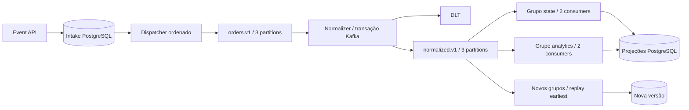

# EventScale — Event Streaming Foundation

Versão de desenvolvimento: **0.1.0-dev**. Plataforma Java para receber fatos de comércio digital e derivar projeções reproduzíveis de um log Kafka. EventScale não cria pedidos, cobra pagamentos nem substitui o sistema transacional externo.

## Problema e escolha de Kafka

Os mesmos eventos precisam alimentar estado de pedidos e analytics de forma independente, manter histórico por retenção e permitir reconstrução. Kafka atende melhor a este problema pelo log durável particionado, offsets por consumer group, replay e ordering por key. RabbitMQ atende o problema de work queue/reliable delivery demonstrado pelo NotifyFlow; não há uma alegação de superioridade universal. Um dispatcher confiável sozinho não oferece os consumidores independentes e o replay que justificam Kafka aqui.



Um backend Spring consolida API, normalizer e grupos independentes; não há microservices artificiais. Java 21, Spring Boot 4.2.0, Spring Kafka 4.2.0, Kafka/client 4.4.0, PostgreSQL 18.7, Flyway, JDBC, Actuator/Micrometer e Testcontainers 2.0.5. [Versões, compatibilidade, pesquisa oficial e advisories](docs/versions.md).

## Contratos e ingestão

`POST /api/v1/events` recebe envelope explícito com eventId UUID, eventType, eventVersion, aggregateId, occurredAt, producer, correlationId e payload. Tipos: order.created, payment.confirmed, order.cancelled, order.shipped, order.delivered. v1 continua suportado; order.created v2 adiciona channel opcional. Sem channel, o normalizer usa unknown. Versões desconhecidas são classificadas, nunca tratadas como v1. JSON versionado foi escolhido pela transparência; não há Schema Registry nem promessa de forward compatibility universal.

O corpo tem limite de 64 KiB antes do parsing. Mesmo eventId/conteúdo canônico retorna recibo idempotente persistente; conteúdo diferente retorna 409. **202 ACCEPTED confirma intake PostgreSQL, não publicação Kafka.** `GET /api/v1/events/{id}` mostra published_at, partition_id e kafka_offset após ack do broker. O dispatcher preserva ordem de admissão por aggregate; um lock global serializa publicação neste milestone. Uma falha após ack e antes do commit de intake pode duplicar registros físicos, tolerados pelas projeções.

Consulte [contratos e exemplo JSON](docs/event-contracts.md) e [OpenAPI](docs/openapi.yaml). `GET /api/v1/orders/{id}` e `GET /api/v1/analytics` consultam projeções assíncronas, não a fonte transacional dos pedidos.

## Topologia, ordering e grupos

| Topic (prefixo eventscale.) | Partitions / RF / minISR | Retenção / cleanup | Producer | Consumer groups |
| --- | --- | --- | --- | --- |
| orders.v1 | 3 / 1 / 1 | 7 dias / delete | dispatcher | eventscale-normalizer-v1 |
| order-events-normalized.v1 | 3 / 1 / 1 | 7 dias / delete | normalizer transacional | order-state-projector-VERSION; analytics-projector-VERSION |
| orders.dlt.v1 | 3 / 1 / 1 | 7 dias / delete | normalizer transacional | inspeção administrativa |

`aggregateId` é a record key. Mesmo aggregate usa a mesma partition sob a topologia fixa; offsets crescentes definem sua ordem. Kafka **não fornece global ordering entre partitions** e não corrige um produtor que envia shipment antes de payment. Contagem de partitions permanece fixa; ampliá-la exige migração de keys. Dois membros por grupo dividem três partitions. Os grupos recebem o mesmo stream independentemente; entrada/saída causa rebalance, com redelivery tolerado.

Tópicos declarados em código, auto-create desativado. LogAppendTime governa retenção; occurredAt permanece no envelope como event time, separado de ingestion/processing time. RF1 não prova HA ou tolerância à perda física do broker. [Detalhes](docs/partitioning-ordering.md).

## Entrega, transações e projeções

Producer: acks=all, idempotence=true, retries explícitos e timeout de entrega de 10 segundos. Idempotência do protocolo Kafka não substitui eventId de negócio.

O estágio **Kafka→Kafka read-process-write usa transações/EOS**: offsets de entrada e saída normalizada/DLT compartilham commit. Consumers usam read_committed; saída abortada fica invisível. As projeções PostgreSQL permanecem **at-least-once com efeito idempotente**, sem atomic commit distribuído Kafka+PostgreSQL. Marker UNIQUE(version, consumer_name, event_id) e mutação compartilham a mesma transação JDBC; offset só é confirmado depois do retorno do listener. Crash após DB commit causa redelivery, sem duplicar efeito lógico. [Semântica completa](docs/delivery-semantics.md).

State deriva CREATED→PAID→SHIPPED→DELIVERED, ou CANCELLED a partir de CREATED/PAID. Ordem de negócio inválida entra em quarantine, sem silêncio ou reorder automático. Analytics conta fatos válidos recebidos e soma pagamentos por moeda independentemente do state; não é um ledger financeiro. Não há janelas: eventos atrasados válidos atualizam analytics acumulado; occurredAt é preservado. Eventos semanticamente repetidos com novos IDs são fatos diferentes.

JSON malformado/tipo/versão inválidos têm uma tentativa de classificação e seguem DLT transacional com coordenadas, categoria, eventId quando disponível e timestamp. Sem payload completo/segredos. Falha de DB é retry, não poison; falha de DLT aborta e mantém offset de entrada, exigindo restaurar o destino. [Modelo de falhas](docs/failure-model.md).

## Replay e evolução

`pwsh ./scripts/replay.ps1 -Version rebuild_20261120` cria outra versão e novos grupos a partir de earliest retido, sem apagar a versão ativa ou resetar offsets. Valide catch-up/equivalência e ative explicitamente pelo ponteiro PostgreSQL. O novo processo deve continuar mantendo a versão ativa. Retenção de sete dias limita a reconstrução; história expirada exige arquivo/snapshot futuro. Replay reconstrói; retry repete tentativa falha; redrive reintroduz falhas selecionadas; reprocessing aplica lógica novamente. [Procedimento](docs/replay.md), [evolução de schema](docs/schema-evolution.md).

## Executar e verificar

Pré-requisitos: Docker, Java 21 para Maven e PowerShell 7 para scripts. Defina DB_PASSWORD somente no ambiente (gere um valor local; não o versione).

```powershell
$env:DB_PASSWORD=[guid]::NewGuid().ToString('N')
docker compose up -d --build --wait --wait-timeout 180
pwsh ./scripts/smoke.ps1
./mvnw.cmd -B -ntp verify
```

Em Linux/macOS, use `./mvnw -B -ntp verify`. Um clean-start descartável usa `docker compose down -v` antes de subir; isso apaga os volumes desse projeto. API em localhost:8080, broker em localhost:9092; PostgreSQL/controller não têm host ports. Não exponha este ambiente plaintext sem autenticação à Internet.

JUnit/AssertJ/Awaitility e Kafka+PostgreSQL **reais** via Testcontainers provam ordering, paralelismo por partition, grupos, duplicatas, crash/DB commit, falhas de DB/broker/DLT, poison, schema, replay e commit/abort/read_committed. Sem mock como prova principal, sem ZooKeeper e sem sincronização por sorte. CI Verify executa a suíte; Container faz build, clean-start e smoke; dependency review/Dependabot exigem revisão de upgrades. [Testes](docs/testing.md), [evidências executadas](docs/evidence.md).

## Observabilidade, operação e limites

Actuator health/readiness inclui Kafka e PostgreSQL. Prometheus expõe produção/falhas, consumo, duplicatas, falhas de projeção, DLT, quarantine, duração e lag por grupo. IDs ficam em logs estruturados, nunca em metric labels. Lag alto pode ser backlog saudável; erro depende de logs/falhas e tendência de recuperação. Marcadores transacionais são considerados na correção de offsets. [Runbook](docs/operations.md).

Sem frontend, AI, RabbitMQ, Redis, Kubernetes ou cloud. Streams foi avaliado e não adiciona estado/window/join útil a esta normalização; Spring Kafka explicita melhor os limites. Sem HA real, benchmark universal, schema governance completa, retenção ilimitada ou autenticação pública. Intake/dedup crescem sem purge automático. [Arquitetura](docs/architecture.md), [ADRs](docs/adr/), [material de estudo](docs/learning/README.md), [relatório de revisão](docs/review-report.md). Licença MIT. Desenvolvimento permanece na feature, sem merge, tag ou Release.

The complete English version follows below.

# EventScale — Event Streaming Foundation (English)

Development version: **0.1.0-dev**. A Java platform that receives externally owned commerce facts and derives reproducible projections from a Kafka log. EventScale does not create orders, charge payments or replace the external transactional system.

## Problem and Kafka choice

The same events must feed order state and analytics independently, retain history and support reconstruction. Kafka fits this problem through its durable partitioned log, independent group offsets, replay and key ordering. RabbitMQ fits the work-queue/reliable-delivery problem demonstrated by NotifyFlow; this is not a universal superiority claim. A reliable dispatcher alone does not provide the independent retained-log processing that makes Kafka necessary here.

The diagram above shows the actual architecture. A single Spring backend consolidates API, normalizer and independent consumer groups without artificial microservices. The stack is Java 21, Spring Boot 4.2.0, Spring Kafka 4.2.0, Kafka/client 4.4.0, PostgreSQL 18.7, Flyway, JDBC, Actuator/Micrometer and Testcontainers 2.0.5. [Version compatibility, official research and advisories](docs/versions.md).

## Contracts and ingestion

`POST /api/v1/events` receives an explicit envelope with eventId UUID, eventType, eventVersion, aggregateId, occurredAt, producer, correlationId and payload. Types are order.created, payment.confirmed, order.cancelled, order.shipped and order.delivered. v1 remains supported; order.created v2 adds optional channel, normalized to unknown when absent. Unsupported versions are classified, never treated as v1. Versioned JSON makes evolution transparent; there is no Schema Registry or universal forward-compatibility promise.

Bodies are limited to 64 KiB before parsing. Same eventId/canonical content returns a durable idempotent receipt; different content returns 409. **202 ACCEPTED confirms PostgreSQL intake, not Kafka publication.** `GET /api/v1/events/{id}` exposes published_at, partition_id and kafka_offset after broker acknowledgement. The dispatcher preserves aggregate admission order using a single logical publication lock. A crash after broker acknowledgement but before intake commit can duplicate physical records; projections tolerate them.

See [contracts and JSON example](docs/event-contracts.md) and [OpenAPI](docs/openapi.yaml). `GET /api/v1/orders/{id}` and `GET /api/v1/analytics` query asynchronous read models, not transactional order truth.

## Topology, ordering and groups

All application topics have three partitions, RF1, minISR1, seven-day retention and delete cleanup. `eventscale.orders.v1` receives dispatcher output and feeds eventscale-normalizer-v1. `eventscale.order-events-normalized.v1` receives transactional normalization and independently feeds order-state-projector-VERSION and analytics-projector-VERSION. `eventscale.orders.dlt.v1` receives transactional validation failures for administrative inspection.

aggregateId is the record key. A fixed partition topology puts one aggregate in one partition with increasing offsets. Kafka **does not provide global ordering across partitions**, and does not fix a producer sending shipment before payment. Partition expansion requires a key-migration plan. Two members per group divide three partitions; groups receive the entire stream independently. Joining/leaving triggers rebalance and potentially duplicate delivery.

Topics are code-declared and auto-create is disabled. LogAppendTime controls retention; occurredAt remains envelope event time, separate from ingestion and processing time. RF1 proves neither HA nor physical broker-loss tolerance. [Details](docs/partitioning-ordering.md).

## Delivery, transactions and projections

Producers explicitly configure acks=all, idempotence=true, retries and a ten-second delivery timeout. Kafka protocol idempotence does not replace business eventId.

The **Kafka→Kafka read-process-write stage uses transactions/EOS**: input offsets and normalized/DLT output commit together. read_committed consumers hide aborted output. PostgreSQL projections remain **at-least-once with idempotent effects**, without distributed atomic Kafka+PostgreSQL commit. A UNIQUE(version, consumer_name, event_id) marker and mutation share one JDBC transaction; offsets are acknowledged after listener return. A crash after DB commit redelivers without another logical effect. [Full delivery semantics](docs/delivery-semantics.md).

State derives CREATED→PAID→SHIPPED→DELIVERED, or CANCELLED from CREATED/PAID. Invalid business order is quarantined, never silently reordered. Independent analytics counts received valid facts and sums confirmed payments by currency; it is not a financial ledger. There are no windows: late valid facts contribute to cumulative analytics and preserve occurredAt. Semantically repeated events with new IDs are different facts.

Malformed JSON, unknown type and unsupported version get one deterministic classification attempt, then a transactional DLT record containing coordinates, category, available eventId and timestamp. No full payload/secrets are copied. DB infrastructure failures retry; DLT failure aborts and retains input offsets until the destination recovers. [Failure model](docs/failure-model.md).

## Replay and evolution

`pwsh ./scripts/replay.ps1 -Version rebuild_20261120` starts a new version and new groups from earliest retained input, preserving active projections and offsets. Validate catch-up/equivalence before explicitly switching the PostgreSQL pointer. Keep the new process maintaining the active version. Seven-day retention limits reconstruction; expired history requires a future archive/snapshot. Replay reconstructs, retry repeats a failed attempt, redrive reintroduces selected failures, and reprocessing applies logic again. [Procedure](docs/replay.md), [schema evolution](docs/schema-evolution.md).

## Run and verify

Docker is required; use Java 21 for Maven and PowerShell 7 for scripts. Set DB_PASSWORD only in the environment using a generated local value. The PowerShell commands above build/start Compose, run smoke and execute Maven verification; Linux/macOS use `./mvnw -B -ntp verify`. Disposable clean-start runs `docker compose down -v` before startup, deleting that project's volumes. API binds localhost:8080 and broker localhost:9092; PostgreSQL/controller have no host ports. Do not expose this unauthenticated plaintext environment to the Internet.

JUnit, AssertJ, Awaitility and **real Kafka/PostgreSQL Testcontainers** prove key ordering, partition parallelism, groups, duplicates, DB-commit crash recovery, DB/broker/DLT failures, poison handling, schemas, replay and transaction commit/abort/read_committed. No mock is the main broker proof, no ZooKeeper is used, and synchronization is deterministic. CI Verify runs the suite; Container performs build, clean-start and smoke; dependency review/Dependabot propose reviewed updates. [Testing](docs/testing.md), [executed evidence](docs/evidence.md).

## Observability, operations and limits

Actuator readiness includes Kafka and PostgreSQL. Prometheus exposes production/failures, consumption, duplicates, projection failures, DLT, quarantine, duration and per-group lag. IDs belong in structured logs, never metric labels. High lag can be healthy backlog; inspect errors and recovery trend. Transaction markers are addressed by offset correction. [Runbook](docs/operations.md).

No frontend, AI, RabbitMQ, Redis, Kubernetes or cloud is included. Streams was evaluated but adds no useful state/window/join to this normalization; Spring Kafka exposes the transaction boundary clearly. No real HA, universal benchmark, full schema governance, unlimited retention or public authentication is claimed. Intake/dedup grow without automatic purge. [Architecture](docs/architecture.md), [ADRs](docs/adr/), [learning materials](docs/learning/README.md), [review report](docs/review-report.md). MIT licensed. Work stays on the feature branch without merges, tags or Releases.
