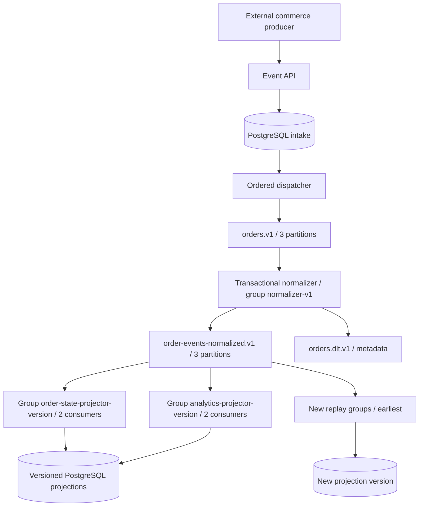

# Architecture

EventScale receives externally owned commerce facts. It does not reserve stock, charge cards, or own transactional orders. PostgreSQL intake is a durable handoff to Kafka; Kafka's retained lifecycle log is the source for all derived read models.

Three deployable services suffice: Kafka (combined KRaft controller/broker), PostgreSQL, and one Spring application containing independent listener groups. Deployables are consolidated; offsets and membership remain separate. Kafka Streams is deliberately omitted after evaluation in versions.md.

## Intake boundary

`POST /api/v1/events` persists a unique eventId and canonical content. 202 ACCEPTED acknowledges storage, not Kafka publication. `GET /api/v1/events/{id}` exposes confirmed publication metadata. Same eventId/content is idempotent; different content returns 409. Object key order is canonicalized; numeric representations remain part of content identity. UUID allocation is the external producer's responsibility; storage detects collisions.

An aggregate advisory lock serializes intake before assigning its sequence. The dispatcher uses a transaction-scoped PostgreSQL lock across instances and publishes the earliest pending row; it waits for broker acknowledgement before marking it published. It never skips an earlier failed row. This intentionally trades intake-dispatch throughput for a small, auditable ordering model. Crashes after broker ack but before DB commit can create physical duplicates. Persistent projection dedup handles them; Kafka producer idempotence alone cannot bridge this boundary.

API request arrival defines the serialized per-aggregate admission order, not occurredAt. Upstream concurrent writers must coordinate business sequence. Partition count stays fixed; increasing it can remap keys and needs a migration plan. Kafka is necessary beyond intake because independent groups retain offsets, fan out the same facts, and rebuild without the API or intake table.

## State and analytics

State transitions: CREATED → PAID → SHIPPED → DELIVERED; CREATED/PAID → CANCELLED. Illegal transitions are recorded in quarantine atomically with deduplication. Analytics independently counts received valid facts and sums payment amounts by currency; it is not an accounting ledger, and does not infer state validity from the other group. Repeating a payment with a **new eventId** is a new fact; upstream must preserve identity on retry.

All analytics is cumulative over retained input/replay horizon; no windows, grace or event-time expiry are implemented. Late events are processed on arrival, preserving occurredAt; an illegal lifecycle order is quarantined rather than reordered. Realistic revenue correction/refund logic is out of scope.

## Durability and security limits

RF=1, minISR=1 and a single controller do not prove HA or tolerance of physical disk/broker loss. Docker volumes survive restarts, not `down -v`. Seven-day retention bounds rebuildability: archive or extend retention before claiming lifetime rebuilds. Intake/dedup currently grow without automatic cleanup; deleting dedup independently is unsafe.

This local portfolio API has no authentication and is bound to loopback in Compose. Do not expose it or Kafka plaintext listeners publicly. PostgreSQL and controller listeners have no host port. Environment provides passwords; no actual credentials are committed. Application runs non-root. Only health and Prometheus management endpoints are exposed, without health details. Body reads are bounded before parsing, including chunked requests; records and decompressed batches are bounded too. All SQL values are parameterized.
